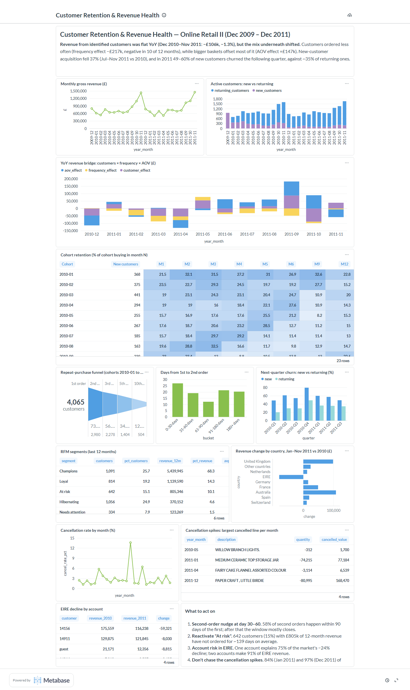

# Customer Retention & Revenue Health: Online Retail II

An end-to-end product analytics project on two years of real transactions (1.07M invoice lines, 5,900 customers, Dec 2009 – Dec 2011). It covers a SQLite star schema, analytical SQL (CTEs and window functions), cohort retention, churn, a repeat-purchase funnel, RFM segmentation, a root-cause revenue bridge, a Metabase dashboard, and a pandas/seaborn notebook with significance tests.



## Key findings

| # | Finding | Evidence |
|---|---|---|
| 1 | **Revenue was flat, but customers ordered less often.** Revenue from identified customers changed −£106k (−1.3%) YoY, Dec 2010 – Nov 2011. Fewer orders per customer cost £217k (negative in 10 of 12 months), and higher average order value recovered £147k. | `sql/07_revenue_bridge_yoy.sql` |
| 2 | **The AOV gain comes from a few large orders, not the typical basket.** The median order value did not move (£304 → £306, Mann-Whitney p = 0.08), so the AOV effect in finding 1 is driven by the wholesale tail. | `notebooks/eda.ipynb` §7 |
| 3 | **Acquisition is shrinking.** New customers fell 37% (Jul–Nov 2011 vs 2010: 808 vs 1,288). | `sql/11_new_customer_acquisition.sql` |
| 4 | **New customers churn far more than returning ones.** In 2011 Q1–Q3, 55% of new customers did not buy the next quarter, against 35% of returning customers (χ² = 146, p < 1e-30). | `sql/05_quarterly_churn.sql`, notebook §6 |
| 5 | **The second order decides retention, and it usually comes early.** 73% of customers place a 2nd order and 56% a 3rd. 58% of 2nd orders arrive within 90 days. | `sql/03_*`, `sql/04_*` |
| 6 | **Revenue is concentrated.** Champions (26% of customers) bring 68% of 12-month revenue; the top 1% of customers bring 32%. 642 "At risk" customers (avg. 139 days since last order) hold £805k. | `sql/06_rfm_segments.sql`, notebook §3 |
| 7 | **Two "alarming" metrics were single events.** The cancellation-rate spikes in Jan 2011 (13.7%) and Dec 2011 (28.3%) are one bulk order each: 84% and 97% of that month's cancelled value. EIRE's −24% is one account, which explains 75% of the drop; two accounts make 91% of EIRE revenue. | `sql/09_*`, `sql/10_*` |

### Recommendations

1. **Trigger a second-order nudge between day 30 and day 60** after the first purchase. Measure it as the change in M1–M3 cohort retention, using a holdout group.
2. **Run a reactivation campaign for the "At risk" segment** (642 accounts, £805k): reorder reminders based on each customer's past cycle.
3. **Add account-level monitoring for small markets.** Here a single customer can swing a country's revenue by a quarter.
4. **Report cancellations with and without single orders above a threshold,** so that one bulk return does not trigger a false alarm.
5. **Look into acquisition before retention.** The returning base is holding; the pipeline of new customers is what is shrinking.

## Data model

```
dim_date ─┐
           ├── fact_sales (one row per invoice line: sales + cancellations)
dim_customer ┤      quantity, unit_price, revenue, is_cancellation, is_non_product
dim_product ─┘
```

**Cleaning** (`scripts/build_warehouse.py`; the `etl_log` table records each step):

| Step | Rows |
|---|---|
| Exact duplicate lines removed | 34,335 |
| Non-sale lines with quantity ≤ 0 or price ≤ 0 removed (stock write-offs, bad-debt entries) | 6,019 |
| Postage, fees and adjustments flagged (not merchandise) | 5,763 |
| Guest checkouts kept, but excluded from customer metrics | 229,202 |

**Caveats handled in the SQL:**
- The 2009-12 cohort is left-censored: it includes everyone who bought before the data starts, so it is excluded from cohort comparisons.
- December 2011 is partial (data ends on the 9th).
- Funnel and second-order timing use only cohorts acquired 2010-01 to 2011-06, so every customer had at least about 5 months to return.
- Month-over-month change is misleading here because of strong November seasonality, so the bridge compares each month with the same month a year earlier.

## SQL

| File | Technique |
|---|---|
| `01_monthly_kpis.sql` | Conditional aggregation, `LAG` for MoM and YoY |
| `02_cohort_retention.sql`, `12_cohort_retention_matrix.sql` | Cohort month arithmetic; long table pivoted to a matrix |
| `03_repeat_purchase_funnel.sql` | `ROW_NUMBER`, `FIRST_VALUE`, `LAG` over funnel steps |
| `04_time_to_second_order.sql` | `julianday` date differences, running cumulative % |
| `05_quarterly_churn.sql` | Self-join on next quarter, new vs returning |
| `06_rfm_segments.sql` | `NTILE(5)` scoring, rule-based segments |
| `07_revenue_bridge_yoy.sql` | Additive decomposition: customers × frequency × AOV |
| `08_country_contribution.sql` | `RANK`, share of total change |
| `09_cancellation_drilldown.sql`, `10_eire_concentration.sql` | Partitioned ranking and share-of-total for root-cause drill-downs |

## Run it

```bash
pip install -r requirements.txt
# 1. Download online_retail_II.xlsx from https://archive.ics.uci.edu/dataset/502/online+retail+ii into data/raw/
python scripts/build_warehouse.py      # builds data/retail.db (about 2 min, mostly reading the xlsx)
python scripts/run_analysis.py         # runs sql/*.sql, writes outputs/*.csv
python scripts/make_notebook.py        # executes notebooks/eda.ipynb, writes docs/*.png
```

**Dashboard:**
1. Put Java 21 and `metabase.jar` in `tools/`.
2. Run `tools/start-metabase.bat`. It binds to 127.0.0.1:3000 only.
3. Run `python scripts/build_metabase_dashboard.py`. It creates a local admin account, connects the SQLite database, and builds the 12 cards and the dashboard through the Metabase API.

## Data source

Chen, D. (2012). *Online Retail II* [Dataset]. UCI Machine Learning Repository. https://doi.org/10.24432/C5CG6D. Licensed under CC BY 4.0. A UK-based online retailer of giftware whose customers are mostly wholesalers.
